<div align="center">

<picture>
  <source media="(prefers-color-scheme: dark)" srcset="images/Ace_dsa_dark.png">
  
</picture>

# Ace DSA

**Master the *thinking* behind coding interviews — anywhere, no laptop required.**

Ace DSA is a mobile app that trains you to recognize Data Structures & Algorithms patterns and pick the optimal approach and complexity for real interview problems, one tap at a time.


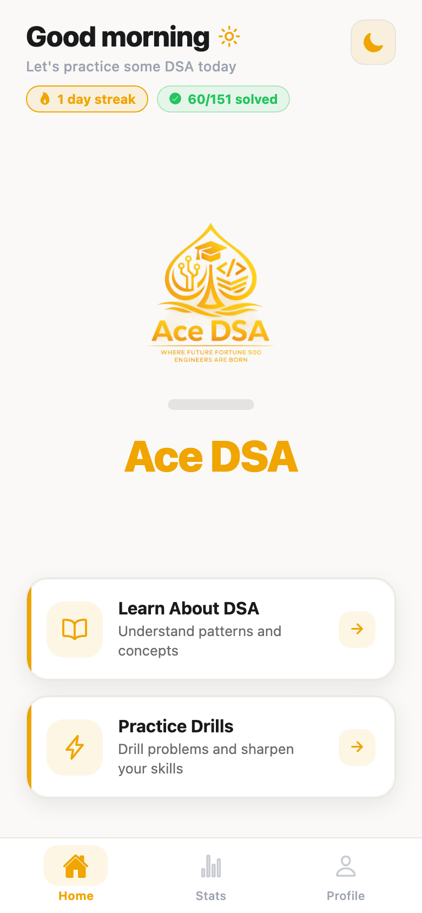&nbsp;
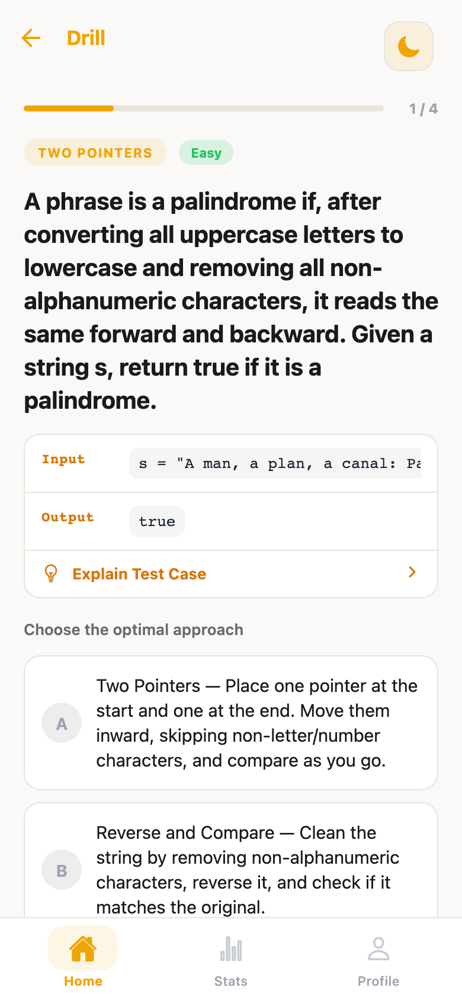&nbsp;
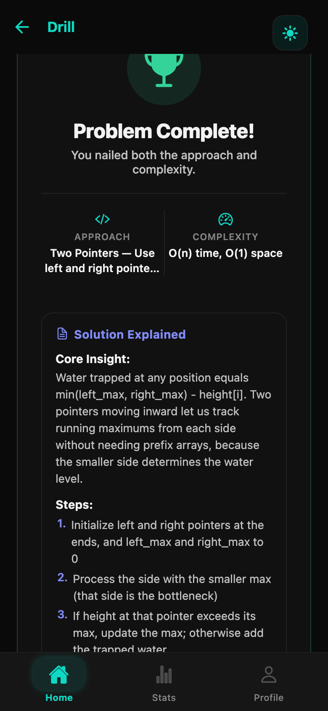&nbsp;
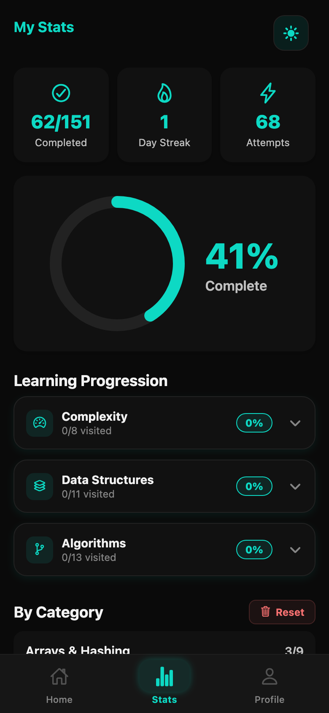

</div>

---

## Table of contents

- [The problem](#the-problem)
- [How Ace DSA solves it](#how-ace-dsa-solves-it)
- [Features](#features)
  - [Guided drills](#1-guided-drills--approach--complexity)
  - [Learn DSA library](#2-learn-dsa--a-visual-pattern-library)
  - [Flashcards](#3-flashcards)
  - [Progress & stats](#4-progress-streaks--stats)
  - [Accounts & profile](#5-accounts-profile--security)
  - [Light & dark themes](#6-light--dark-themes)
- [Content coverage](#content-coverage)
- [Architecture](#architecture)
- [Tech stack](#tech-stack)
- [Getting started](#getting-started)
- [API reference](#api-reference)
- [Repo structure](#repo-structure)
- [Testing & CI](#testing--ci)
- [Roadmap](#roadmap)
- [License](#license)

---

## The problem

Most DSA prep tools assume you're sitting at a desk with an IDE open. That leaves some real gaps:

| Pain point | Why it hurts |
|---|---|
| **Typing code is the bottleneck, not the hard part** | In interviews, people rarely fail on syntax. They fail because they don't spot that a problem is a *sliding window* or a *two-pointer* problem. Typing full solutions on a phone is painful, so most people don't practice when they're away from a laptop. |
| **Dead time goes unused** | Commutes, bus rides, waiting in line: you have plenty of 5-minute gaps, but LeetCode-style practice needs a 45-minute block at a desk. |
| **Complexity analysis gets skipped** | Interviewers always ask "what's the time and space complexity?", but most practice platforms only check whether your code passes. Nobody drills Big-O on its own. |
| **Patterns are learned in isolation** | Tutorials explain *what* a heap is, but not *when* to reach for one. Seeing "brute force → why it's slow → optimized pattern" side by side is rare. |
| **Progress is invisible** | It's hard to tell which patterns you're weak on when you've only been tracking how many problems you've solved. |

## How Ace DSA solves it

Ace DSA turns every interview problem into a **two-step decision drill**:

1. **Pick the optimal approach.** Four plausible strategies, one of which is best. Wrong picks give you a targeted hint instead of the answer.
2. **Pick the time and space complexity** of that approach.

There's no code to type, so a full rep takes under a minute and works one-handed on a phone. After each drill you get a full explanation: the core insight, step-by-step reasoning, and real solution code. That connects *recognizing the pattern* to *implementing it*.

Alongside the drills there's a visual **Learn** library and **flashcards** for the underlying concepts, plus **per-pattern stats** that show exactly where you need more practice.

---

## Features

### 1. Guided drills: approach → complexity

The core of the app: **151 curated interview problems** across **18 pattern categories**, each tagged Easy, Medium or Hard.

- **Pick a category or go Random.** Focus on a weak spot such as *Graphs* or *1-D DP*, or mix everything.
- **Problem statement with a real test case.** Each drill shows sample input and output, and *Explain Test Case* opens a walkthrough of why that input produces that output.
- **Hints instead of answers.** A wrong choice is greyed out and a hint appears, nudging you toward the key insight. You keep trying until you get it, so you learn it rather than just reading the answer.
- **Complexity round.** Once you've found the approach, you choose its Big-O time and space from four options.
- **Full explanation when you finish.** A "Problem Complete" summary shows your approach and complexity, then *Solution Explained* (core insight and numbered steps) and syntax-highlighted *Solution Code*.
- **Drill queue.** *Next Problem* moves you through the category without going back to the menu.

<p align="center">
  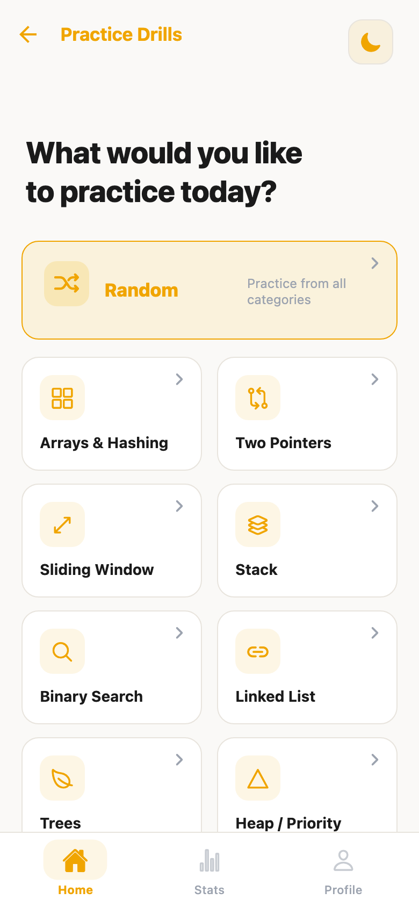
  
  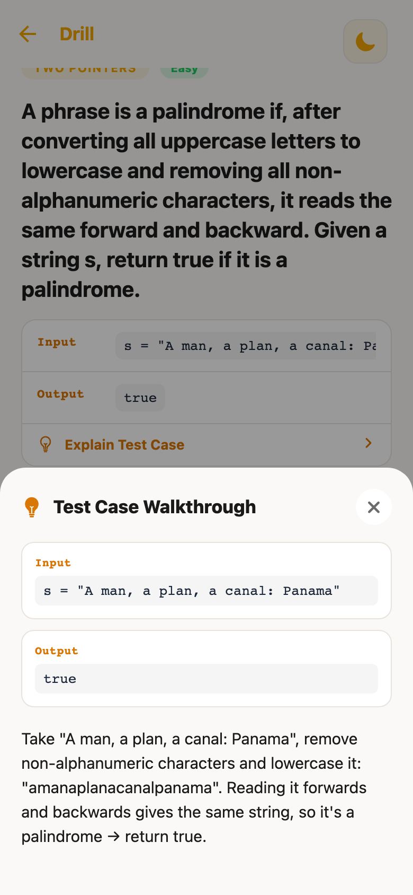
  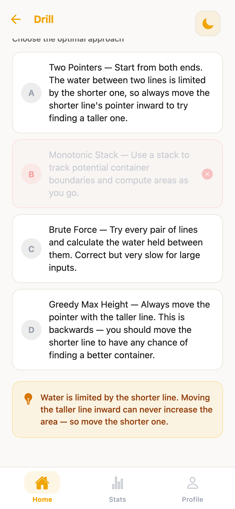
</p>
<p align="center">
  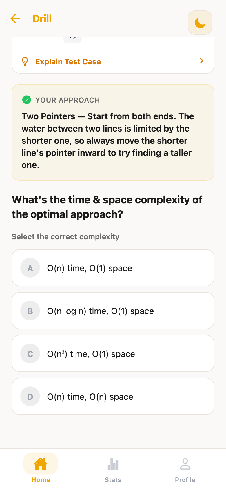
  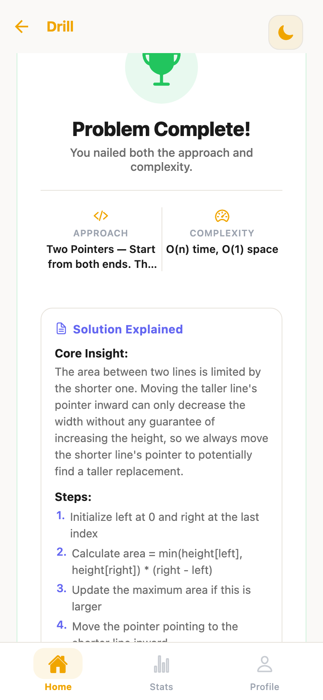
  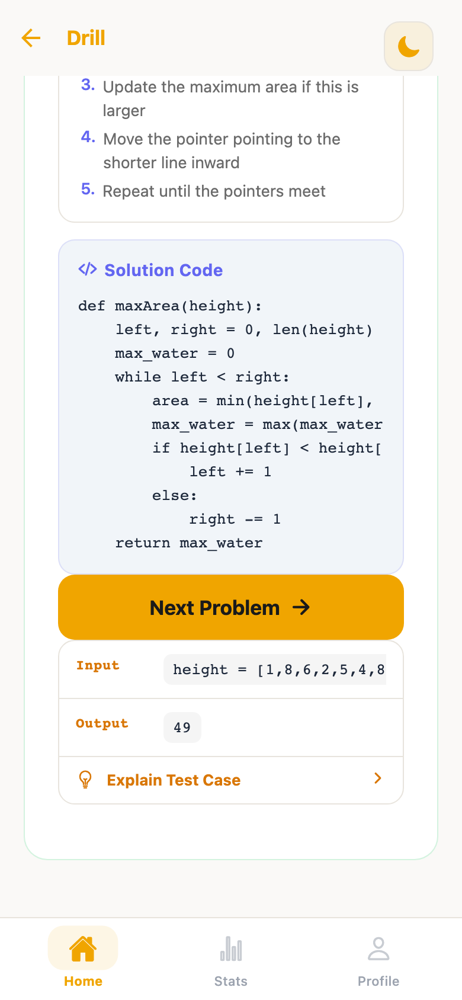
</p>

<p align="center"><sub>Category picker → problem + test case → walkthrough → hint on a wrong pick → complexity round → solution breakdown</sub></p>

### 2. Learn DSA: a visual pattern library

A structured, illustrated curriculum split into three tracks: **Complexity**, **Data Structures** and **Algorithms**.

- **Illustrated topic cards.** Every topic has a custom diagram (arrays, linked lists, heaps, Dijkstra and more) in both light and dark versions, plus a short "what you're looking at" explanation.
- **Ordered steps.** Topics are numbered so beginners can work through them in order.
- **Cross-linked patterns.** Data-structure cards link to the algorithms that use them (for example, Arrays → *Two Pointers*, *Sliding Window*).
- **In-depth guides.** Each algorithm guide covers *What it does*, *How it's used and why it helps*, *Where it's optimal*, a **brute-force solution**, the **optimized solution**, and practice prompts, with runnable Python code blocks.
- **Search** across all topics, and a **progress bar** per track.

<p align="center">
  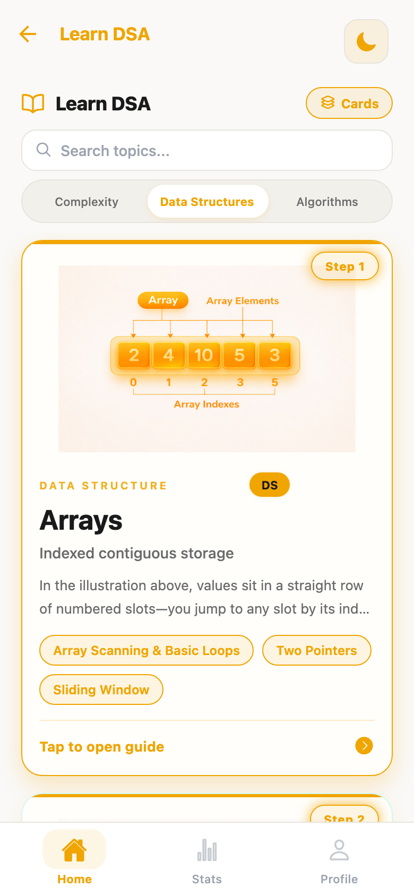
  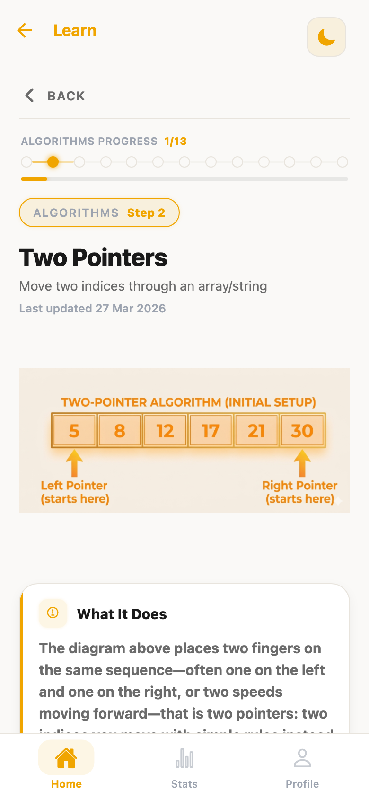
  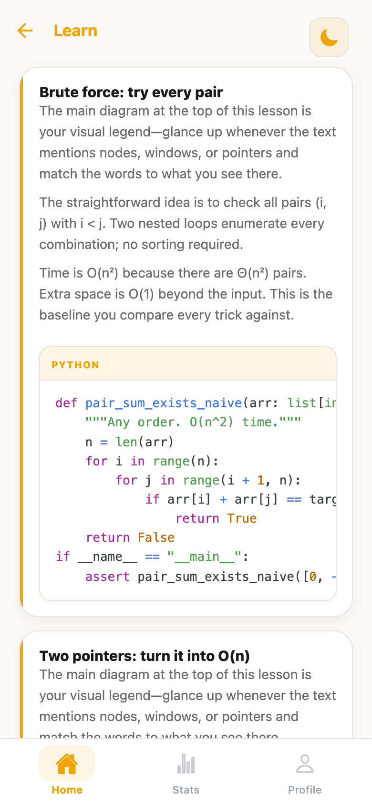
</p>

### 3. Flashcards

Quick-review mode for every Learn track. Each card shows the topic and its illustration, and you flip it to see the summary and key points. Arrows and a progress indicator move you through the deck. It's a good fit for spaced review in short sessions.

<p align="center">
  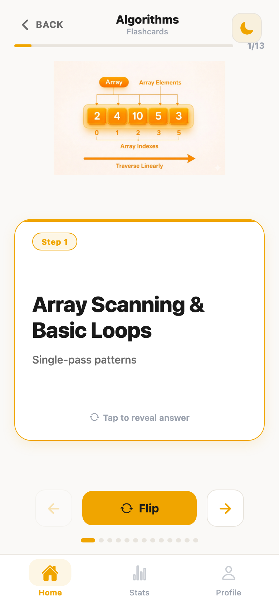
  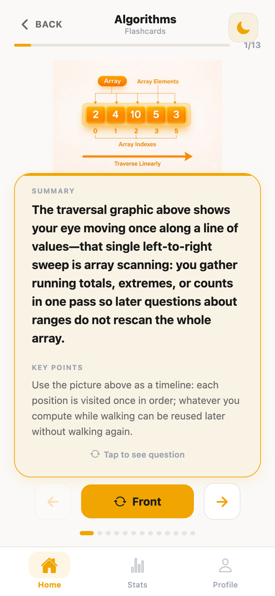
</p>

### 4. Progress, streaks & stats

- **Home dashboard** with a time-of-day greeting, your **daily streak** and **problems solved**.
- **My Stats:** completion ring, total attempts, streak, and **Learning Progression** for each Learn track.
- **By-category breakdown:** a progress bar for each of the 18 patterns, so your weak spots are easy to see.
- **Reset** your drill stats at any time to start a fresh run.

<p align="center">
  
  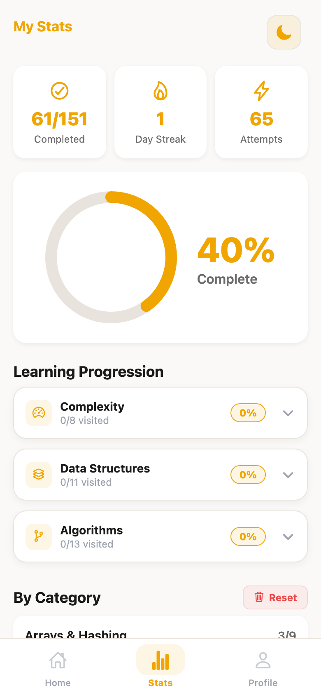
  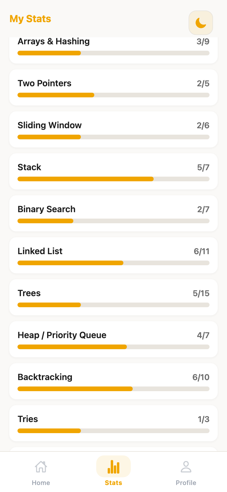
</p>

### 5. Accounts, profile & security

- Sign up and log in with **email or username**, using **JWT access and refresh tokens** stored in the device's secure storage (Expo SecureStore).
- **Email verification** and **forgot / reset password** flows via SendGrid.
- **Profile:** edit your name and username, change your password, see your progress at a glance, or **delete your account**.
- Server-side hardening: login **rate limiting and brute-force protection**, request body limits, panic recovery, request IDs, structured logging and a `/metrics` endpoint.
- An **offline banner** shows when the app can't reach the API.

<p align="center">
  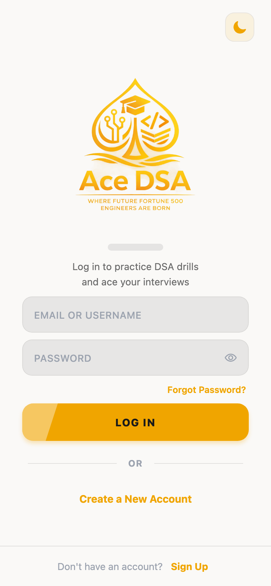
  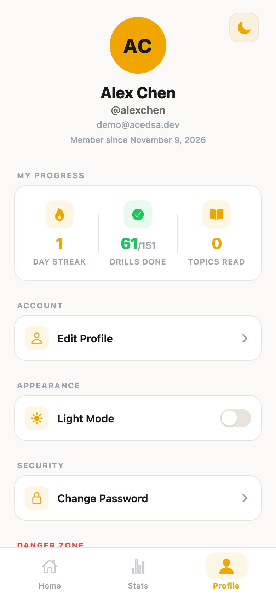
</p>

### 6. Light & dark themes

A warm gold light theme and a teal-on-black dark theme. Toggle from any screen or from your profile. Your choice is saved, and every illustration has a matching dark variant.

<p align="center">
  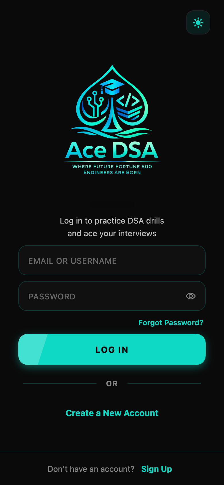
  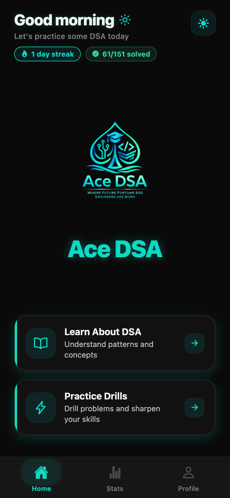
  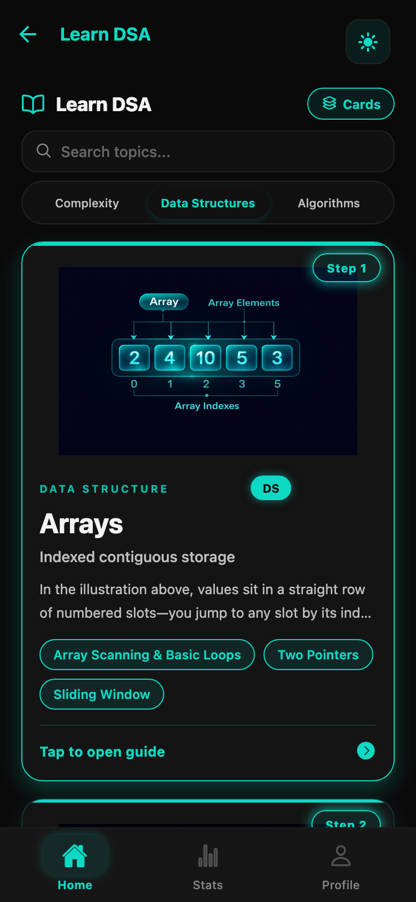
  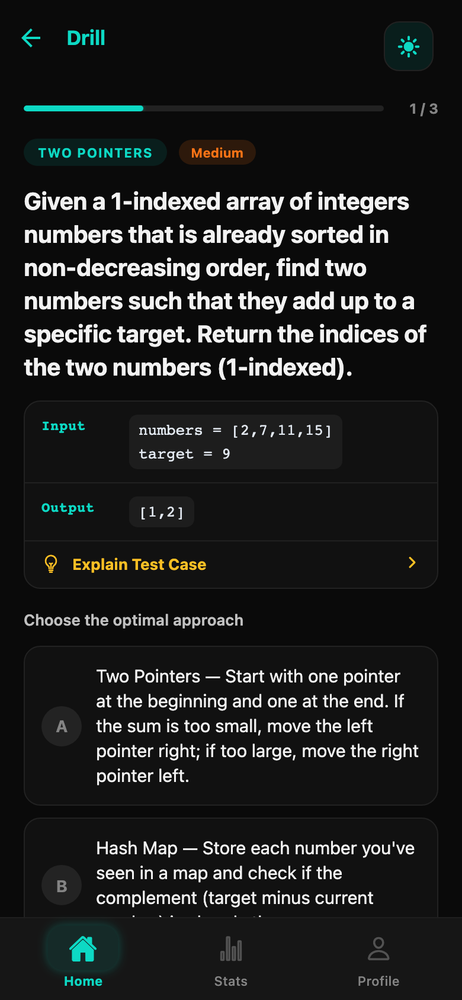
  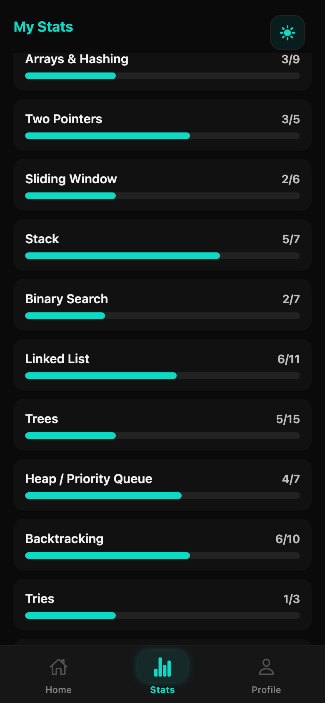
</p>

---

## Content coverage

**Drills: 151 problems** (28 easy · 101 medium · 22 hard)

| Category | # | Category | # |
|---|---|---|---|
| Arrays & Hashing | 9 | Tries | 3 |
| Two Pointers | 5 | Graphs | 13 |
| Sliding Window | 6 | Advanced Graphs | 6 |
| Stack | 7 | 1-D Dynamic Programming | 12 |
| Binary Search | 7 | 2-D Dynamic Programming | 11 |
| Linked List | 11 | Greedy | 8 |
| Trees | 15 | Intervals | 6 |
| Heap / Priority Queue | 7 | Math & Geometry | 8 |
| Backtracking | 10 | Bit Manipulation | 7 |

**Learn library: 32 topics**

- **Complexity (8):** What is Big O?, O(1), O(log n), O(n), O(n log n), O(n²), O(2ⁿ), space complexity
- **Data Structures (11):** Arrays, Strings, Linked Lists, Stacks, Queues & Deques, Hash Tables/Sets, Trees & Binary Trees, BSTs, Heaps & Priority Queues, Graphs, Tries
- **Algorithms (13):** Array Scanning, Two Pointers, Sliding Window, Binary Search, Recursion, Backtracking, Sorting & Comparators, BFS, DFS, Dijkstra's, Greedy, 1-D DP, 2-D DP & Strings

---

## Architecture

```
┌──────────────────────────┐       HTTPS / JSON       ┌───────────────────────────┐        ┌──────────────┐
│  Mobile app (Expo / RN)  │  ──────────────────────▶ │   Go API (net/http)       │ ─────▶ │  PostgreSQL  │
│  iOS · Android · Web     │   JWT access + refresh    │   auth · drills · attempts│  pgx   │  (Supabase   │
│  SecureStore tokens      │ ◀──────────────────────  │   stats · profile · email │        │   compatible)│
└──────────────────────────┘                           └─────────────┬─────────────┘        └──────────────┘
                                                                     │
                                                                     ▼
                                                              SendGrid (email)
```

- **Mobile:** React Native and Expo with React Navigation (bottom tabs plus a native stack). Context providers handle auth, theme, network status and notifications. Learn content is bundled with the app so it works offline.
- **Backend:** Go standard library HTTP with no framework. SQL migrations are embedded and run on startup, and `cmd/seed` loads the 151-problem drill set.
- **Database:** PostgreSQL with users, drills and attempts. Stats (per-category completion, streak) are computed from attempts.

---

## Tech stack

| Area | Technologies |
|------|--------------|
| **Mobile** | React Native 0.81, Expo SDK 54, TypeScript, React Navigation 7, Axios, react-native-svg, react-syntax-highlighter |
| **Backend** | Go 1.26, `net/http`, pgx, JWT, bcrypt |
| **Database** | PostgreSQL 17 (local, Docker or [Supabase](https://supabase.com)) |
| **Email** | SendGrid (verification and password reset) |
| **Dev / ops** | Make, Docker Compose, GitHub Actions, EAS Build |

---

## Getting started

### Prerequisites

- **Node.js** 20.19.4+ (required by Expo SDK 54)
- **Go** 1.26+
- **PostgreSQL**, either local, via Docker, or a hosted URL such as Supabase
- *(Optional)* **Expo Go** on your phone for on-device testing

### 1. Backend + database

**Option A: Docker (simplest)**

```bash
docker compose up -d      # Postgres on :5432 + API on :8080
make seed                 # load the 151 drills (uses DB_URL from env / backend/.env)
```

**Option B: run the API locally**

```bash
cp backend/.env.example backend/.env
# Edit backend/.env → DB_URL, JWT_SECRET (32+ chars), PORT
# Optional: SENDGRID_API_KEY, SENDGRID_FROM for verification / reset emails

make run                  # migrations run automatically on startup
make seed                 # load drill data
curl http://localhost:8080/health   # → ok
```

See [docs/GETTING_STARTED.md](docs/GETTING_STARTED.md) for Supabase setup details.

### 2. Mobile app

```bash
cd mobile
npm install
npx expo start
```

- Press **w** to open it in your browser, **i** for the iOS simulator, or **a** for the Android emulator.
- Or scan the QR code with **Expo Go** (your phone and computer need to be on the same Wi-Fi).

The app finds the API automatically: it uses `EXPO_PUBLIC_API_BASE_URL` if set, otherwise `localhost:8080`, rewritten to your machine's LAN IP when running in Expo Go. To point it somewhere else:

```bash
EXPO_PUBLIC_API_BASE_URL=https://your-api.example.com npx expo start
```

See [docs/DEPLOYMENT.md](docs/DEPLOYMENT.md) for production and EAS builds.

---

## API reference

| Method | Endpoint | Auth | Description |
|--------|----------|------|-------------|
| `GET` | `/health` · `/readyz` | — | Liveness / readiness (DB ping) |
| `GET` | `/metrics` | — | Request metrics |
| `POST` | `/auth/signup` | — | Create account, returns tokens, sends verification email |
| `POST` | `/auth/login` | — | Log in with email or username (rate-limited) |
| `POST` | `/auth/refresh` | — | Exchange refresh token for a new access token |
| `POST` | `/auth/verify-email` | — | Confirm email address |
| `POST` | `/auth/forgot-password` | — | Send password reset email |
| `POST` | `/auth/verify-reset-token` · `/auth/reset-password` | — | Complete password reset |
| `GET` | `/drills` · `/drills/{id}` | — | List drills / get one |
| `GET` | `/drills/categories` | Optional | Categories (with per-user progress when authenticated) |
| `POST` | `/attempts` | JWT | Submit a drill attempt |
| `GET` | `/me/attempts` | JWT | Attempt history |
| `GET` · `DELETE` | `/me/stats` · `/me/stats/reset` | JWT | Per-category stats + streak / reset |
| `GET` | `/me/progress` | JWT | Learn progress |
| `GET` `PUT` | `/me/profile` | JWT | View / edit profile |
| `PUT` | `/me/password` | JWT | Change password |
| `DELETE` | `/me/account` | JWT | Delete account |

---

## Repo structure

```
Ace_DSA/
├── mobile/                      # React Native (Expo) app
│   ├── App.tsx
│   └── src/
│       ├── screens/             # Auth, Welcome, Home, Learn, LearnDetail, Flashcard,
│       │                        # Drills, DrillDetail, Practice, Stats, Profile
│       ├── components/          # HomeCard, ThemeToggle, LearnCodeBlock, SpinningLogo, …
│       ├── context/             # Auth, Theme, Network, Notification providers
│       ├── navigation/          # RootNavigator, AuthStack, MainTabs
│       ├── data/learn/          # Learn curriculum (brute → optimized → practice per topic)
│       ├── services/            # Axios client + JWT interceptor, secure storage
│       └── types/
├── backend/
│   ├── cmd/api/                 # API entrypoint
│   ├── cmd/seed/                # Drill seeder (nc150.json)
│   ├── internal/
│   │   ├── auth/                # Signup, login, refresh, verification, reset
│   │   ├── drills/  attempts/  stats/  profile/
│   │   ├── email/               # SendGrid
│   │   ├── middleware/          # JWT, CORS, rate limit, brute-force, logging, metrics, …
│   │   └── db/                  # Connection + embedded migrations
│   └── Dockerfile
├── images/                      # Learn illustrations (light + dark)
├── docs/                        # Getting started, deployment, screenshots
├── docker-compose.yml
└── Makefile
```

---

## Testing & CI

```bash
make test         # go test ./...
make vet          # go vet ./...
make fmt          # gofmt
make mobile-lint  # tsc --noEmit
```

GitHub Actions runs `go test -race`, `go vet` and a gofmt check on every push and PR to `main` that touches `backend/`.

---

## Roadmap

- [x] Go API: auth, drills, attempts, stats, profile
- [x] 151 seeded drills with explanations, test cases and solution code
- [x] Learn library, flashcards, light and dark themes
- [x] Email verification and password reset
- [ ] In-app AI tutor (prompt-engineered DSA coach)
- [ ] AWS / Terraform infrastructure
- [ ] App Store / Play Store release

---

## License

MIT. See [LICENSE](LICENSE).
